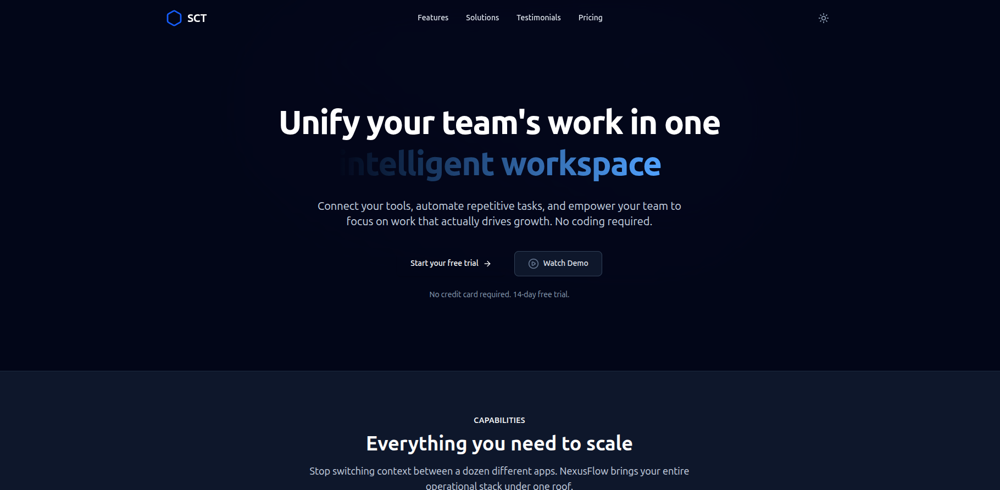

# SCT - Modern Responsive Landing Page

[](https://sct-wd-1-kappa-opal.vercel.app/)
[](https://reactjs.org/)
[](https://tailwindcss.com/)
[](https://vitejs.dev/)

A highly polished, responsive landing page built. This project focuses heavily on clean UI/UX principles, smooth animations, and a highly interactive navigation system.

**[View Live Demo (Click Me)](https://sct-wd-1-woad.vercel.app/)**

## 📸 Preview



---

## Key Features

- **Advanced Interactive Navigation**:
  - Fixed header that monitors scroll position.
  - Transparent at the top, transitioning seamlessly into a glassmorphism (backdrop-blur) style when scrolling down.
  - Smooth scale-x underline animations on hover.
- **Full Dark Mode Support**: Implemented utilizing Tailwind CSS v4's native dark mode variant mapping, easily toggled via the navigation bar.
- **100% Responsive Design**: Flawless layout scaling from mobile screens to ultra-wide desktop monitors, featuring a custom animated mobile hamburger menu.
- **Modern UI Components**: Features grid-based layout sections including a Hero, Features List, Solutions, Testimonials, and Pricing tiers.
- **Clean Architecture**: Built with modular, reusable React components and custom React Hooks (e.g., `useScrollPosition`).

## 🛠️ Tech Stack

- **Frontend Framework**: React.js
- **Build Tool**: Vite
- **Styling**: Tailwind CSS v4
- **Icons**: Lucide React
- **Utility Libraries**: `clsx`, `tailwind-merge` (for dynamic class name handling)

## Project Structure

```text
src/
├── components/
│   ├── layout/         # Navbar, Footer
│   └── ui/             # Reusable atomic components (Container, Button)
├── hooks/              # Custom hooks (useScrollPosition)
├── pages/
│   └── Home/
│       ├── sections/   # Hero, Features, Solutions, Pricing, Testimonials
│       └── index.jsx   # Page assembly
├── utils/              # Helper functions (classnames merger)
├── index.css           # Global Tailwind v4 base styles
└── main.jsx            # React Entry Point
```

## Local Installation & Setup

Want to run this project locally? Follow these steps:

1. **Clone the repository**
   ```bash
   git clone https://github.com/mihir-ax/SCT_WD_4.git
   cd SCT_WD_4
   ```

2. **Install dependencies**
   ```bash
   npm install
   ```

3. **Run the development server**
   ```bash
   npm run dev
   ```

4. **Open your browser**
   Navigate to `http://localhost:5173` to see the application running.
